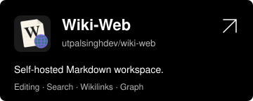

<h1 align="center"><b>Full Stack TypeScript Developer</b></h1>

Utpal Singh · Delhi, India

---

## Contributed to

<b>Merged pull requests</b>

 

**[Plannotator](https://github.com/backnotprop/plannotator)**
- [fix(print): make HTML explainers printable](https://github.com/backnotprop/plannotator/pull/2580)
- [fix(review): load private GitHub attachment images](https://github.com/backnotprop/plannotator/pull/2579)
- [fix(pi): preserve gated reviews and route feedback to their opener](https://github.com/backnotprop/plannotator/pull/2581)
- [fix(annotate): keep Contents in sync after scrolling and file switches](https://github.com/backnotprop/plannotator/pull/2403)
- [fix(vscode): restore select-all in chat and comment inputs](https://github.com/backnotprop/plannotator/pull/2431)
- [fix: close uninstall host integration recovery gaps](https://github.com/backnotprop/plannotator/pull/2226)
- [fix(inbox): open relative Markdown links in attachments](https://github.com/backnotprop/plannotator/pull/2363)
- [fix(review): prevent partial diffs from crashing code review](https://github.com/backnotprop/plannotator/pull/2361)
- [fix: scroll to headings in Inbox Markdown attachments](https://github.com/backnotprop/plannotator/pull/2316)
- [fix: support isolated localhost preference cookies](https://github.com/backnotprop/plannotator/pull/2188)
- [fix(opencode): wait for plugins before the OpenCode 2 update command](https://github.com/backnotprop/plannotator/pull/2277)
- [fix: load local images in Inbox Markdown attachments](https://github.com/backnotprop/plannotator/pull/2285)
- [feat: add rich-text selection copy with a separate shortcut](https://github.com/backnotprop/plannotator/pull/2191)
- [fix: hide pending annotations on hidden slides](https://github.com/backnotprop/plannotator/pull/2185)
- [fix: offer manual Inbox notes for Cursor](https://github.com/backnotprop/plannotator/pull/2153)
- [fix: watch directories instead of files on Linux](https://github.com/backnotprop/plannotator/pull/2155)
- [fix: support fixed ports for live app proxies](https://github.com/backnotprop/plannotator/pull/2145)
- [fix: preserve Pi turn when replacing an Ask AI question](https://github.com/backnotprop/plannotator/pull/2126)

**[Handy](https://github.com/cjpais/Handy)**
- [fix: restore shortcut fallback when manager startup fails](https://github.com/cjpais/Handy/pull/2327)

**[OpenConcho](https://github.com/offendingcommit/openconcho)**
- [fix: surface workspace deletion errors](https://github.com/offendingcommit/openconcho/pull/105)
- [feat: make workspace title link to overview](https://github.com/offendingcommit/openconcho/pull/104)
- [feat: warn when Honcho token is missing](https://github.com/offendingcommit/openconcho/pull/103)

**[Executor](https://github.com/UsefulSoftwareCo/executor)**
- [Use the public origin for browser approval URLs](https://github.com/UsefulSoftwareCo/executor/pull/1967)

## Projects

---

## Tech Stack

<b>All skills</b>

 

**Languages**

**Frontend**

**Backend**

**Tools**

